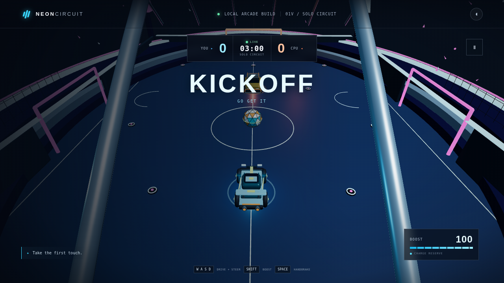

# Neon Circuit

A browser-playable, single-player arcade car-soccer game. Drive the Rift Runner, challenge a CPU rival, and score in the Aurora Skydome.

**Play the game:** [https://tsotrade1-afk.github.io/](https://tsotrade1-afk.github.io/)  
**First public release:** [Neon Circuit v1.0.0](https://github.com/tsotrade1-afk/tsotrade1-afk.github.io/releases/tag/v1.0.0)

## Gameplay screenshots

**3D arena**



**2D compatibility mode** (used when WebGL2 is unavailable)


## What’s in the game

- One player versus a live CPU opponent with ball-seeking, attacking, defending, and boost behavior.
- Three-minute matches, goals, kickoff resets, pause, restart, and rematch. A match also ends early if either side reaches five goals.
- Arcade-style driving, steering, boost with a recharging reserve, handbrake drifting, and car/ball contact.
- Keyboard controls and on-screen touch controls on touch-sized layouts.
- A 3D presentation using the Aurora SkyDome arena, Rift Runner and Bulwark cars, and Pulse Ball. If WebGL2 is unavailable, a simpler 2D renderer keeps the match playable.

## Controls

| Action | Keyboard |
| --- | --- |
| Accelerate | **W** or **Up** |
| Reverse / brake | **S** or **Down** |
| Steer | **A / D** or **Left / Right** |
| Boost (while accelerating) | **Shift** |
| Handbrake / sharper drift | **Space** |
| Pause / resume | **Esc** or the on-screen pause button |

On touch-sized layouts, use the on-screen **GO**, **REV**, **BOOST**, and steering buttons.

## Run locally

Requires Node.js **20.19+** or **22.12+**.

```sh
git clone https://github.com/tsotrade1-afk/tsotrade1-afk.github.io.git
cd tsotrade1-afk.github.io
npm ci
npm run dev
```

Open the local URL printed by Vite (normally `http://localhost:5173`). To create and preview a production build:

```sh
npm run build
npm run preview
```

The production files are written to `dist/` and can be served from the root of any static web host.

## Scope and limitations

Neon Circuit is a local, single-player arcade demo—not an online service. It has no multiplayer, online accounts, persistent statistics, or leaderboard. Its driving, contacts, ball bounce/gravity, boundaries, and goal checks use custom simplified arcade logic; it is **not** a full rigid-body physics simulation, and no Rocket League-equivalent physics are claimed. Stadium decoration is not generally collidable. Sound effects are not included, and the visible sound toggle is inactive in this version.

The 2D compatibility renderer is a simplified visual fallback. It preserves the core match logic, but does not provide the full 3D arena presentation. Browser and device performance may vary.

## Release

See the [v1.0.0 release notes and downloadable source/build ZIP](https://github.com/tsotrade1-afk/tsotrade1-afk.github.io/releases/tag/v1.0.0).
