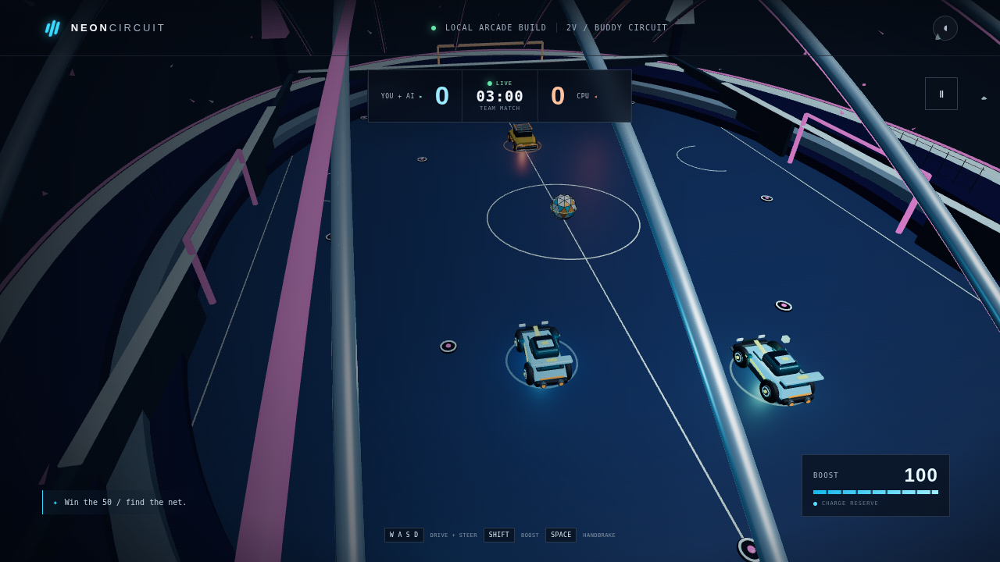
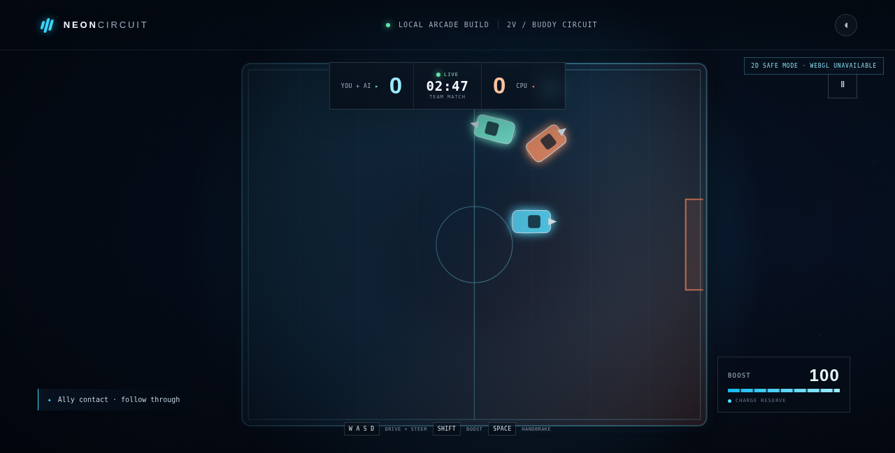

# Neon Circuit

A browser-playable local arcade car-soccer game. The current game pairs you with a friendly AI teammate against a CPU rival on an expanded Aurora Skydome pitch.

**Play the current game:** [https://tsotrade1-afk.github.io/](https://tsotrade1-afk.github.io/)  
**Original public release (v1.0.0):** [release notes and original source/build ZIP](https://github.com/tsotrade1-afk/tsotrade1-afk.github.io/releases/tag/v1.0.0)

The v1.0.0 release, source archive, and original Blender assets are preserved unchanged. The live game has since received a 2v1 AI-team gameplay update; no new GitHub Release was created.

## Gameplay screenshots

**Current 3D team match**

**2D compatibility mode** (used when WebGL2 is unavailable)

## What’s in the current game

- One human driver and one friendly AI teammate against the CPU rival.
- A roughly **64 × 50 m** playable pitch—about **83% more floor area** than the original **47.3 × 37 m** field—with scaled 3D arena art and matching 2D markings.
- Boundary handling keeps cars inside the field; the ball rebounds from side/end walls and only scores through the goal aperture.
- The teammate seeks a support lane and can challenge the ball; the CPU attacks and defends.
- Three-minute matches, goals, kickoff resets, pause, restart, rematch and a five-goal early finish.
- Arcade steering, boost with a recharging reserve, handbrake drifting, keyboard controls and on-screen mobile controls.
- The 3D arena, cars and ball use the included GLB art; the 2D fallback keeps the same core match logic when WebGL2 is unavailable.

## Controls

| Action | Keyboard |
| --- | --- |
| Accelerate | **W** or **Up** |
| Reverse / brake | **S** or **Down** |
| Steer | **A / D** or **Left / Right** |
| Boost (while accelerating) | **Shift** |
| Handbrake / sharper drift | **Space** |
| Pause / resume | **Esc** or the on-screen pause button |

On touch-sized layouts, use the on-screen **GO**, **REV**, **BOOST**, and steering buttons.

## Scope and physics limitations

Neon Circuit is a local single-player demo: the teammate is AI-controlled, not another human or an online player. There are no online accounts, multiplayer service, persistent statistics, or leaderboard. Vehicle movement, car/ball contacts, gravity, wall response and goal checks use simplified custom arcade logic—not a full rigid-body physics engine. Boundary resolution is discrete and uses approximate body-sized collision footprints; very high-speed impacts may not look fully realistic. Decorative stadium geometry is not generally collidable. Sound effects are not included, and the visible sound toggle is inactive.

## Source and release history

The existing [v1.0.0 release](https://github.com/tsotrade1-afk/tsotrade1-afk.github.io/releases/tag/v1.0.0) remains the first public release and its downloadable source/build ZIP remains unchanged. The current 1.0.1 gameplay update is deployed to the same Pages site without creating a new repository or release.
